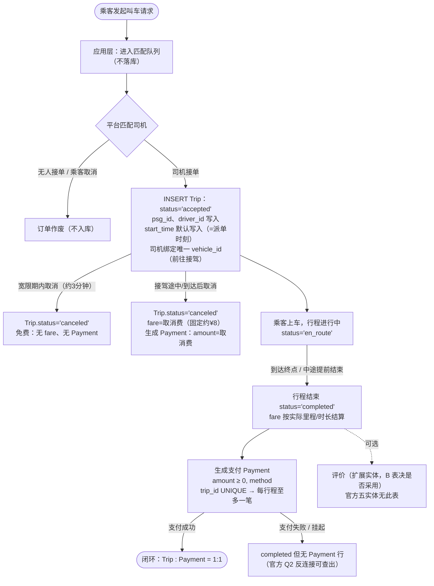

# A1 · 业务流程图草图（网约车订单与行程调度）

> 陈祎楠 / 角色 A · 2026-10-22 · v1.3.1（D-06 v1.1 改名同步：取消两类结果 + 完成单计费）· 状态：草稿
> 用途：供 B 建模参考；A8 复核 ER 时以此对照。

## 0. 决策 D-05（Trip 入库时点）：保持官方 DDL 不变，Trip 在派单成功时才入库

- **内容**：下单与匹配属应用层请求阶段，不落库；司机接单（派单成功）时才 `INSERT Trip`。
- **理由**：① 官方 `Trip.driver_id INT NOT NULL`——无司机根本无法插行；② 保持官方 DDL 原样，ER/DDL/Q1–Q3 与官方答案完全对齐；③ `start_time DEFAULT CURRENT_TIMESTAMP` 在 INSERT 时填充，即"派单成功时刻"，语义自洽。
- **已知代价**（写进文档的取舍）：匹配阶段取消的订单不留在 Trip 表（下单转化率类分析超出本库能力）；`start_time` 实为派单时刻而非上车时刻，属官方模式的已知近似。
- **待办**：B 在设计决策登记表确认（ER 结构不受影响，仅数据字典语义说明）；E3 登记。
- **命名说明**：本决策组内登记号一律用 **D-05**——评审期的临时名"D1"与角色 D（凌彤）的任务号 D1 冲突，弃用。

## 1. 主链路（下单 → 派单 → 行程 → 支付 →（评价），含取消两类结果与完成单计费，D-06 v1.1）



纯文本版（防 Mermaid 不渲染）：

```
乘客叫车 ──▶ 应用层匹配队列（不落库，D-05）──▶ 平台派单
                    │                            │
          ┌─────────┴─────────┐        ┌────────┴─────────┐
      无人接/乘客取消       司机接单：INSERT Trip(accepted)
          │                 (psg_id, driver_id, start_time=派单时刻)
    订单作废（不入库）              │
              ┌──────────────────┼────────────────────┐
        宽限期内取消         接驾途中/到达后取消        乘客上车 en_route
              │                   │                      │
        canceled 免费       canceled+取消费(¥8)      到终点/中途提前结束
        (无fare无Payment)   fare=取消费,有Payment         │
                                                        completed
                                                    fare 按实际里程/时长
                                                        │        └-(可选)─▶ 评价
                                                        ▼
                                              生成 Payment(amount≥0, method,
                                              trip_id UNIQUE→至多一笔)
                                              ├─ 成功 → Trip:Payment = 1:1 闭环
                                              └─ 失败/挂起 → 无 Payment 行（Q2 查出）
```

## 2. 阶段 × 实体对照表（B 建模时直接用）

| # | 阶段 | 触发者 | 系统动作 | 涉及实体与关键字段 | 状态值 |
|---|---|---|---|---|---|
| 1 | 下单/匹配 | 乘客/平台 | 应用层匹配队列，**不落库**（D-05：`driver_id NOT NULL`，无司机不能建行） | （无） | — |
| 2 | 派单/接驾 | 平台/司机 | **INSERT Trip**：乘客、司机、时间一次写入；校验司机绑车；不换司机由**应用层保证**；司机前往接驾 | `Trip(psg_id, driver_id, start_time 默认=INSERT 时刻)`；`Driver.vehicle_id`(UNIQUE)→`Vehicle` | `accepted` |
| 3 | 行程 | 司机/乘客 | 乘客上车，行程进行中 | `Trip.status` | `en_route` |
| 4 | 结束/取消 | 司机/乘客 | 取消两类结果（宽限期免费 / 超宽限期收**取消费**）+ 行程结束（含提前结束）按实际计费（见下表，D-06 v1.1） | `Trip.fare`, `Trip.status` | `completed` / `canceled` |
| 5 | 支付 | 平台 | 生成唯一支付记录并扣款（正常车费或取消费共用同一 Payment 通道） | `Payment(trip_id UNIQUE, amount CHECK≥0, method)` | — |
| 6 | 评价 | 乘客 | （扩展项）挂在**行程完成后**，与支付结果无关 | 拟议扩展实体，不影响官方底座 | — |

### 取消/结束计费口径：取消两类结果 + 完成单计费（决策 D-06 v1.1，数值为课程化简化、全组可调）

| 情形 | 判定 | status | fare | Payment | 依据来源 |
|---|---|---|---|---|---|
| ① 宽限期内取消 | 接单后宽限期内取消（Uber 原文：宽限期**因城市而异**；本文取 3 分钟为课程简化值） | `canceled` | 无 | 无 | 来源 3（Uber Help：宽限期内不收取消费） |
| ② 超宽限期取消 | ①超出宽限期乘客取消；②司机到达等待后乘客未出现（司机取消）；③司机接驾异常迟缓时**豁免**（回到①） | `canceled` | **取消费**（官方原文：*"pay drivers for the time and effort they spend getting to your location"*，补偿接驾空驶；金额因城市/产品而异，本文取固定 ¥8 为课程简化值） | **有**：amount=取消费 | 来源 3（取消费触发条件与用途）+ 来源 2（任何收费必须落持久化事务记录→取消费也生成 Payment） |
| ③ 上车后中途结束（提前结束）※完成单计费，非取消结果 | 已 `en_route` | `completed` | 按实际里程/时长正常计费 | 正常支付 | 服务已实际提供；官方 Q1/Q3 以 completed/车费为口径，提前结束是真收入 |

**三条边界要点**：
- **分界线 = 乘客是否上车（en_route）**：上车后不存在"取消"，只有"提前结束"（= completed）；取消只发生在上车前。
- **canceled 不必然无 Payment**（情形②有取消费支付）——与官方完全兼容：`Payment.trip_id UNIQUE` 照样成立；官方 Q2 只筛 `completed`，不受影响。
- **官方 Q3（每车累计车费）无 status 过滤**，取消费自然计入——司机实际所得，语义正确。

## 3. 给 B 的三条建模提示（对应官方得分点）

1. **两条特殊基数**来自流程本身：派单时司机必须已绑车 → `Driver:Vehicle = N:1`（`Driver.vehicle_id UNIQUE`）；每笔行程（无论车费还是取消费）至多一笔支付 → `Trip:Payment = 1:1`（`Payment.trip_id UNIQUE`）。
2. **status 建议值**：官方仅要求 `completed` 能被过滤（`status` 为无约束 `VARCHAR(20)`）；库内建议值 `accepted / en_route / completed / canceled`（**小组约定，D-05 下不存在 requested**）。是否加 CHECK 由 B、C 决定（注意 <8.0 版本 CHECK 被静默忽略）。
3. **Q2 的业务来源是支付挂起，不是取消**：官方 Q2 只筛 `completed` 且无 Payment 的行程（漏付/挂账，需对账催收）；`canceled` 行不进 Q2（被 WHERE 排除）——无论其有无取消费 Payment。另：匹配阶段取消的订单不入库（D-05 取舍），涉及"下单量"的分析超出本库能力，写作时列入已知局限。

## 4. 公开资料来源（3 篇，收档前由 E 核验链接与细则）

| # | 来源 | 用途 |
|---|---|---|
| 1 | [NYC Taxi & Limousine Commission — TLC Trip Record Data](https://www.nyc.gov/site/tlc/about/tlc-trip-record-data.page)（官方数据页与数据字典，nyc.gov/site/tlc） | 真实网约车（FHVHV）字段口径、车费组件字段命名（base fare / 里程 / 时长）参照（同时是 A4 的对比路线） |
| 2 | Uber Engineering Blog — *Why Uber Engineering Switched from Postgres to MySQL*（eng.uber.com） | 核心交易库选型/一致性真实案例（呼应 §1.3 权衡）；"任何收费必须是一条持久化事务记录"的口径依据（取消费也生成 Payment） |
| 3 | [Uber Help — *Am I charged for cancelling a trip?*](https://help.uber.com/en/riders/article/am-i-charged-for-cancelling-a-trip-?nodeId=5f6415dc-dfdb-4d64-927a-66bb06bc4f82)（**URL 已核验，2026-10-22 抓取**）+ 辅助条目 *Cancelling a ride*（宽限期 3 分钟口径） | 业务链路第一手口径：取消费触发（超宽限期/到达未现）、官方用途定义（补偿司机接驾时间与路程）、豁免（接驾异常迟缓）、争议通道（Review my cancellation fee）。本文宽限期/金额为课程化简化值，Uber 实际因城市/产品而异 |

> 备选第 4 篇（页数富余再用）：Jiao et al., *Real-world Ride-hailing Vehicle Repositioning using Deep Reinforcement Learning*, Transportation Research Part C, 2019——真实网约车运营时序/高峰特征，可支撑 A3 的负载假设。

## 5. 修订记录

- v1.0（10-22）：初稿。
- v1.1（10-22）：吸收决策 D1 及外部审核 9 条修改——下单阶段移至应用层不落库、取消拆分"作废/接单后取消"两路、派单=INSERT 时点、start_time 时点纠正、评价改挂行程完成、status 建议值去 requested 且定性为小组约定、Q2 业务来源纠正为支付挂起。
- v1.2（10-22）：新增"提前结束 vs 取消"边界口径——en_route 后结束（含提前）= completed、按实际计费；en_route 前取消 = canceled。决策名由评审期临时名"D1"统一为登记号 D-05（v1.1 修订记录保留原名属历史记录）。
- v1.3（10-22）：按三篇公开来源升级为**三段式取消计费**（决策 D-06）——①宽限期内取消免费（无 fare 无 Payment）；②超宽限期取消收取消费（canceled + fare=取消费 + 有 Payment；含到达未现/司机取消触发，接驾迟缓可豁免）；③上车后中途提前结束 = completed 按实际里程/时长计费。取消从单一 X1 拆为 X1a/X1b；"canceled 无 Payment"旧口径作废；S 节点明确"乘客上车"为取消/完成分界。来源 3 已替换为**已核验的 help.uber.com 官方条目**（宽限期因城市而异、取消费官方定义均已按原文校准）。
- v1.3.1（10-23）：随 D-06 v1.1 改名——"三段式取消计费"改称"**接单后取消的两类结果 + 完成单计费规则**"（B 提案、组内收敛）：①②为取消的两类结果，③明确属完成单计费而非取消结果；规则、数值、流程图零改动。
